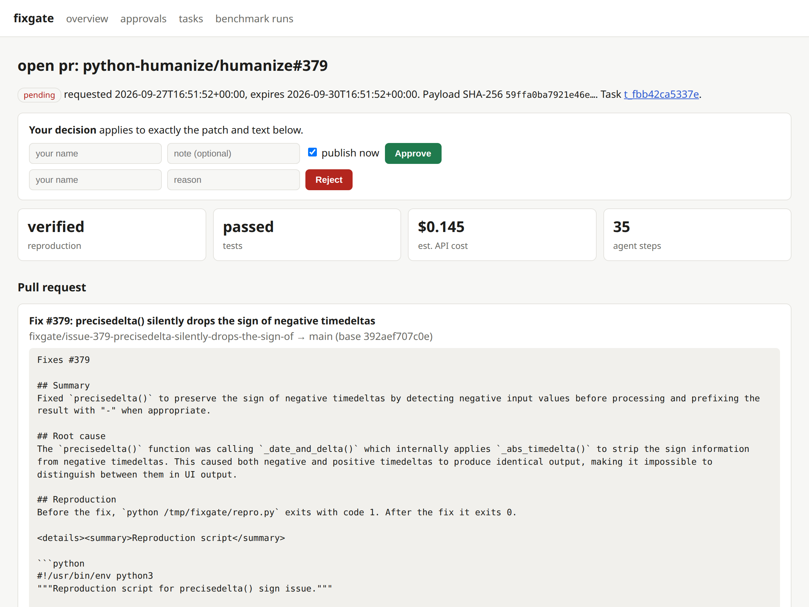
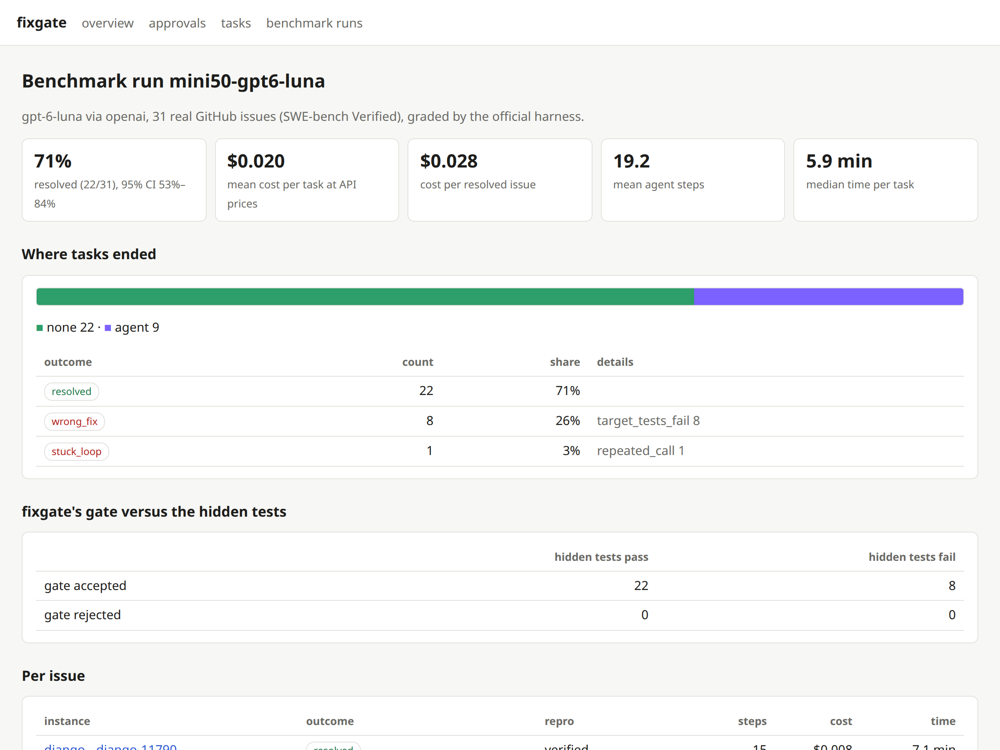
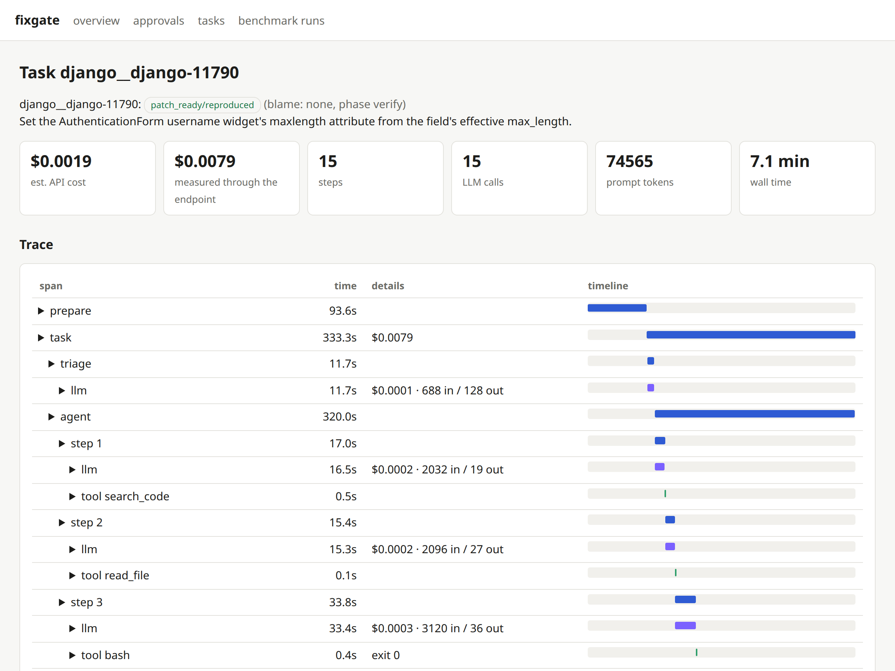

# fixgate

An agent that takes a GitHub issue, triages it, reproduces the bug in a sandbox, writes a fix, checks the
fix itself, and opens a draft pull request only after a person approves the exact patch.

Most agent demos show the happy path. fixgate is mostly about the other paths: what happens when the
model loops, sends broken tool calls, runs out of budget, edits the tests instead of the code, hits a rate
limit, or produces a fix that only looks right. Each of those ends in a named outcome from a
[failure taxonomy](docs/failure-taxonomy.md), with a full trace, instead of a crash or a silent bad PR.

```
issue ──► triage ──► reproduce ──► fix ──► verify ──► human approval ──► draft PR
           (1 call)   (sandbox:     (edit     (fixgate re-runs  (approves one exact
                      must fail     tools)    repro + tests,    patch, bound by
                      before fix)             checks policy)    SHA-256)
```

## Results

Full numbers, method and caveats: [docs/results.md](docs/results.md).

**Real GitHub issues (SWE-bench Verified mini, official grader).** With OpenAI `gpt-6-luna`, fixgate
resolved **22 of 31 issues (71%, 95% CI 53% to 84%)** at about **$0.02 per issue** at API list prices. The run
is incomplete: the ChatGPT account behind the development gateway hit its Codex limit after 31 of the 50
issues (it resets 2026-10-26). The 31 are the first 31 in dataset order; nothing was skipped or rerun.

| | |
|---|---|
| Resolved (hidden tests pass) | 22 / 31 (Django 19/25, Sphinx 3/6) |
| Failure breakdown | 8 wrong fixes (passed fixgate's checks, failed hidden tests), 1 stuck loop |
| Gate precision | 22 of the 30 patches fixgate accepted were correct |
| Reproductions | verified for 29 of 31; 20 of those also pass against the maintainers' real fix |
| Cost per issue | $0.020 mean, $0.004 with prompt caching (estimates; Codex reports no usage for tool calls) |
| Steps / time per issue | 19 steps mean; 6 minutes median through the gateway |

**Triage (136 maintainer-labelled issues from pytest, black, poetry, pandas).** 69.9% accuracy over bug /
feature / docs / question with Claude Haiku 4.5; 94% of bugs recognised, but only 28% of usage questions,
which mostly read like bug reports until a maintainer investigates.

**Live mode.** `fixgate run python-humanize/humanize#379` produced a verified, source-only fix that now waits
in the approval queue. Its first attempt faked a missing test dependency; fixgate's gate missed that and the
human review caught it (details below).


| Approval page: one exact patch, with its reproduction and tests | Benchmark report |
|---|---|
|  |  |

Every task keeps a trace (`fixgate trace`, the web page, or any OpenTelemetry backend):



## What is in the box

| Requirement | How fixgate does it | Code |
|---|---|---|
| Tool use | Five working tools (`bash`, `read_file`, `write_file`, `edit_file`, `search_code`) and three phase tools (`report_reproduction`, `submit_fix`, `give_up`), all validated against JSON Schema | `tools/`, `agent/pipeline.py` |
| Sandboxing | One Docker container per task: no network, all capabilities dropped, no-new-privileges, memory/CPU/PID/file-size limits, per-command timeouts, output capped head+tail, writes confined to the repo and a scratch folder, no secrets inside | `sandbox/docker.py`, `tools/policy.py` |
| Retries | Rate limits wait for the reset (bounded); overload, 5xx, timeouts and connection errors back off with jitter; bad requests, auth errors and refusals fail fast; context overflow clears old results once; GitHub calls retry on rate limits and 5xx | `llm/retry.py`, `github.py` |
| Cost cap | Per task: dollars, prompt tokens, output tokens, steps and wall-clock time, checked before every model call; a budget warning is sent to the agent at 80%; a run-wide dollar cap and a subscription quota guard for benchmarks | `budget.py`, `eval/runner.py` |
| Trace logging | Every task writes spans (task > phase > step > llm / tool / verify) with tokens, cost, exit codes and timings, plus full request/response payloads, secrets redacted; `fixgate trace` prints a tree, the web page draws a timeline | `tracing.py`, `redact.py`, `web/` |
| Human approval | A verified patch becomes an approval request holding the exact PR payload and its hash; approve or reject from the CLI or a local web page; publishing refuses anything unapproved, expired or changed; every decision is in an audit log | `approval.py`, `publish.py` |
| Failure taxonomy | 19 mutually exclusive outcomes, each with a blame (agent, guardrail, infra, human, none), assigned by code | `taxonomy.py` |

## Guardrails that caught real problems during development

These are not hypothetical. Each one fired while building and running fixgate:

- **Stuck-loop detection** ended a run where the model re-sent the same failing `write_file` call four
  times in a row.
- **Empty tool arguments.** Through the development gateway, long sessions made the model imitate the
  gateway's text rendering of earlier tool calls, and the next call arrived with no arguments. The loop
  reports this to the model and counts it; the root cause was fixed by sending prose history through the
  gateway (see [design notes](docs/design.md#development-through-the-rag-gateway)).
- **Stale bytecode.** An edit that keeps a file's size, made within the same second as the previous run,
  made Python execute the old `.pyc`: the reproduction "still failed" after a correct fix. The edit tools
  now drop the module's bytecode, and the baseline test run purges it around the stash.
- **Argument coercion.** Models sometimes send `"start_line": "12"` or `[12]`. Harmless slips are fixed
  and counted; anything else is rejected with a message the model can act on.
- **The gate itself.** On the first benchmark pilot the agent changed the serializer and updated the
  existing tests to match, and everything passed locally, but the issue had asked for a different output
  format. The hidden tests caught it. That is why fixgate reports gate precision separately from the
  success rate.
- **A faked test dependency, caught by the human step.** In the first live run (`python-humanize/humanize#379`)
  the sandbox setup asked pip for a `test` extra while the project calls it `tests`; pip only warns, so
  `freezegun` was missing. The agent "fixed" that by adding a `conftest.py` that replaced `freezegun` in
  `sys.modules` with a mock, and the tests passed. fixgate's gate let it through; the reviewer rejected it
  on the approval page. Now the setup requests every common extra name and installs test requirement
  files, the patch policy blocks module stubs in test code, and the prompt forbids faking dependencies.
  The rerun produced a clean, source-only patch.
- **Reproductions that do not reproduce anything.** Auditing the benchmark traces turned up two weak
  reproductions: one script copied the buggy regular expression into itself instead of calling Django
  (and the agent later "fixed" the copy), and one failed with its own `TypeError` rather than the bug.
  fixgate now rejects a reproduction whose traceback ends in the script's own code with anything but an
  assertion, and re-runs the verified version of the script at submit time, so an agent cannot weaken
  its reproduction until it passes.
- **Quota walls.** Subscription limits arrive as three different messages ("resets at 2:30am", "Resets in
  6h25m27s", "try again at Oct 26th, 2026 11:22 PM"). The retry layer parses all three, waits when the reset
  is within `rate_limit_max_wait_s` (the wait does not count against the task's time budget), and fails the
  call at once when it is weeks away.

## Quick start

Requirements: Python 3.10+, Docker, and either API keys or the local
[RAG gateway](https://github.com/abhishekacharya200/RAG-Gateway) for development.

```bash
git clone https://github.com/abhishekacharya200/fixgate.git && cd fixgate
python -m venv .venv && . .venv/bin/activate
pip install -e ".[web,eval,tokens]"
fixgate doctor          # checks Docker, the LLM endpoint, prices and GitHub access
```

### Choosing the model endpoint

fixgate calls models through the official Anthropic, OpenAI and Google SDKs, so the same code runs in
development and production:

| | development (subscriptions through the RAG gateway) | production (API keys) |
|---|---|---|
| `llm.base_url` | `http://127.0.0.1:8787` (default) | `""` (the provider's API) |
| key | none needed | `FIXGATE_LLM_API_KEY` |
| tool history | prose (`history_format = "auto"`) | native tool blocks |
| prompt caching | off (the gateway cannot use it) | on |

Pick the provider and model with `llm.provider` (`anthropic`, `openai`, `gemini`) and `llm.model`, or the
`FIXGATE_PROVIDER` / `FIXGATE_MODEL` environment variables. See [`fixgate.example.toml`](fixgate.example.toml)
for every setting.

### Fixing a real issue

```bash
fixgate run owner/repo#123
```

This clones the repository, starts a sandbox from the repository's configured image, runs its setup
commands with network access, cuts the network, and runs the agent. If the patch passes fixgate's checks
you get an approval request:

```bash
fixgate show apr_1a2b3c                 # the PR title, body, reproduction and full patch
fixgate approve apr_1a2b3c              # approves and opens the draft PR (on your fork by default)
fixgate reject apr_1a2b3c --reason "wrong layer"
fixgate serve                           # the same, in a local web page, with the trace timeline
```

Other commands: `fixgate triage owner/repo#123 [--propose]` (triage only; `--propose` asks for approval
to add labels and a comment), `fixgate watch owner/repo --label fixgate` (process newly labelled issues),
`fixgate tasks`, `fixgate trace <task>` (add `--otlp file.json` or `--otlp-endpoint http://collector:4318`
to export it as OpenTelemetry), `fixgate approvals`, `fixgate sandbox-gc`. New approval requests can be posted
to a Slack-compatible webhook (`[approval] notify_webhook`). Running fixgate as a service:
[docs/deploy.md](docs/deploy.md).

## Benchmark

The proof runs on [SWE-bench Verified](https://www.swebench.com/): real GitHub issues from real projects,
each with hidden tests written by the maintainers. The default set is the 50-issue
[Verified mini](https://huggingface.co/datasets/MariusHobbhahn/swe-bench-verified-mini) subset (25 Django,
25 Sphinx).

```bash
fixgate eval run --run-id my-run --subset mini --workers 2 --quota-guard
fixgate eval grade --run-id my-run            # the official swebench harness, unchanged
fixgate eval repro-check --run-id my-run      # do the agent's reproductions fail before, pass after the real fix?
fixgate eval report --run-id my-run --print
```

Triage is measured separately, against the labels maintainers gave real issues:

```bash
fixgate eval triage-collect --per-label 8     # closed issues from pytest, black, poetry and pandas (GitHub API)
fixgate eval triage --run-id my-triage        # accuracy, per-class precision/recall, confusion matrix
```

How the numbers are kept honest:

- The agent sees only the issue text and the repository at the base commit, in the official image for
  that instance. It never sees the hidden tests, the test names, the maintainers' patch or the hints
  field. It gets one repository-level testing hint of the kind a CONTRIBUTING file gives ("Django uses
  `./tests/runtests.py <app_label>`").
- Grading uses `swebench.harness.run_evaluation` as published.
- The success rate counts only patches that passed fixgate's own gate, because that is what production
  would propose. Patches the gate stopped are graded separately to measure the gate.
- Each instance runs once. `--retry-infra` reruns only infrastructure failures (LLM API, sandbox, internal
  errors); agent failures are final.
- Costs are reported two ways: tokens as measured through the gateway, and an estimate for the real API
  with prompt caching. Both are labelled.

## Security model

| Threat | Mitigation |
|---|---|
| Prompt injection in the issue text | The issue is wrapped as untrusted data in the user turn; rules live in the system prompt; the sandbox has nothing worth stealing and no way out; a human reviews the exact patch |
| The agent damages the host | Docker isolation with no network, no capabilities, resource limits and timeouts; the container is removed after the task |
| Secret leakage | Tokens never enter the sandbox; traces, logs, the database and PR bodies are redacted; a patch that adds a secret is blocked |
| Reward hacking (editing tests to pass) | Deleting tests or adding skip/xfail markers is blocked; the reproduction and tests are re-run by fixgate, not reported by the model |
| An unreviewed or altered PR | Publishing requires an approved, unexpired request whose payload still matches its SHA-256; the approved patch is applied to a fresh clone at the recorded base commit |
| Spam from retries | Publishing is idempotent: a second attempt finds the existing PR |
| Cross-site requests to the local page | Bound to 127.0.0.1, Host header checked, a per-process form token on every decision |

## Limitations

- Live mode supports Python repositories (the default setup installs the package in a virtual
  environment); other ecosystems need a repository profile with their image and setup commands.
- The sandbox runs as root inside the SWE-bench images (as those images require); isolation relies on the
  container boundary, dropped capabilities and no network.
- Through the development gateway, token counts include each CLI's own framing (about 340 tokens per call
  for Claude Code, about 4,300 for Codex), and Codex does not report usage for tool-call turns, so those
  are counted locally with a tokenizer and marked as estimated.

## Development

```bash
pip install -e ".[dev]"
python -m pytest -q          # 101 tests; the Docker tests are skipped when Docker is not available
```

[`docs/design.md`](docs/design.md) explains the architecture and the decisions behind it.

## License

MIT
